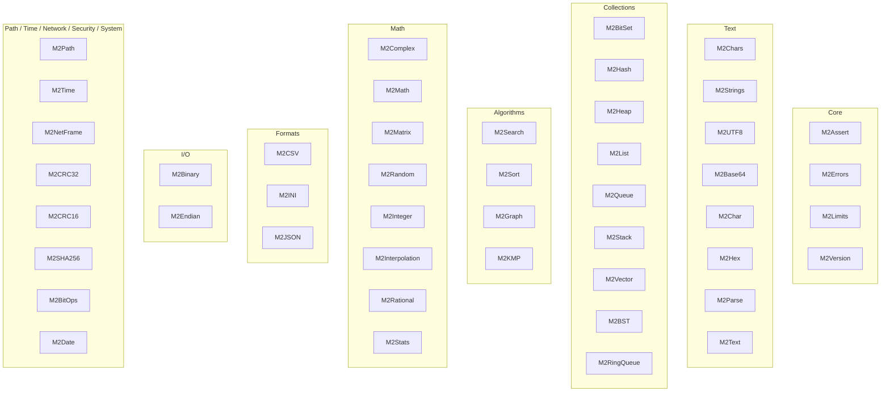
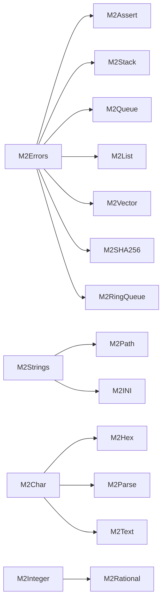
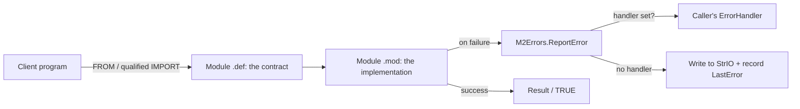
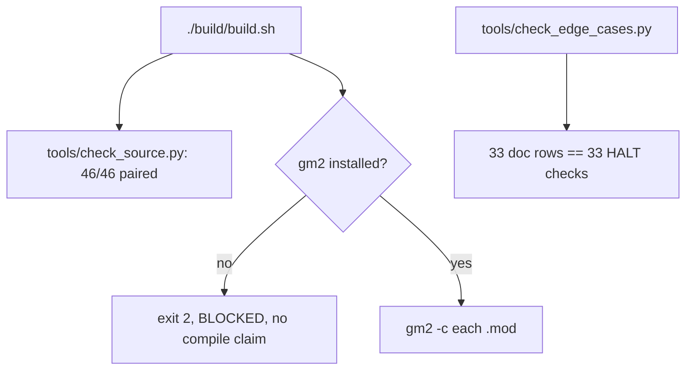

<!-- SPDX-License-Identifier: LicenseRef-Sovereign-Leviathan-SL-AGPL3-001 -->
<!-- Copyright (c) 2026 Ahmad Ali Parr. All rights reserved. -->
<!-- Authored by Ahmad Ali Parr. -->
<!-- Licensed under the SNAPKITTY OPAQUE SOURCE LICENSE v1.0. See LICENSE. -->

# M2Lib — Modula-2 Library

[](https://en.wikipedia.org/wiki/Modula-2)
[](docs/MODULES.md)
[](docs/MODULES.md)
[](examples/)
[](docs/edge-cases.md)
[](docs/architecture.md)
[](LICENSE)

M2Lib is a Modula-2 standard library: **46 paired modules** (`.def` definition +
`.mod` implementation), organized by domain, covering collections, text,
math, formats, I/O, dates, checksums, and graphs. Every module has exactly
one definition and one implementation. The library is written for a classic
Modula-2 module model with GNU Modula-2 runtime assumptions where stated.

> License: SNAPKITTY OPAQUE SOURCE LICENSE v1.0
> (`LicenseRef-Sovereign-Leviathan-SL-AGPL3-001`). See `LICENSE`.
> Every file in the repo carries the Opaque header, except the two
> `LICENSE` files themselves (which start with the SPDX identifier) and
> four build artifacts in `archive/` (two `.json`, two `.log`) where a
> header would corrupt the data or falsify the log. No `.txt`, `.zip`,
> or source-dump files remain.

## What M2Lib is

M2Lib represents two generations of the same library, kept honest about
what each one is:

- **Main tree** — the 2026-10-19 "complete" generation (30 modules), plus
  the first generation's code that it lacked (16 whole modules and unique
  procedures in 13 more), merged procedure-by-procedure. Nothing in the
  main tree was removed or replaced; additions are additive only.
- **`archive/`** — the 2026-10-18 first generation (34 modules), preserved
  as the record of where the merged code came from. The two generations
  are divergent rewrites, not increments: all 18 overlapping module names
  have different APIs, so they were never merged into a single tree by
  overwriting.

What the library does, in one sentence: it gives a Modula-2 program the
everyday building blocks — dynamic arrays, lists, queues, stacks, trees,
graphs, strings, UTF-8, JSON/CSV/INI handling, byte-order and binary I/O,
dates, random numbers, statistics, rationals, checksums — behind small,
explicit, fail-closed APIs. Every procedure documents its failure mode in
its return value (`BOOLEAN` success, `FALSE` on bad input) instead of
crashing or fabricating a result.

## Features

| Feature | What it means in M2Lib |
|---|---|
| Paired modules | 46 modules, each with one `.def` (the contract) and one `.mod` (the implementation). No definition-only or implementation-only modules. |
| Fail-closed APIs | Procedures return `BOOLEAN` success or a safe default. `M2SHA256.DigestHex` returns `FALSE` and empties its output rather than returning a fabricated digest. |
| Two APIs where generations differ | `M2Binary`, `M2Matrix`, `M2Random`, `M2Sort` carry both generations' APIs side by side instead of one silently replacing the other. |
| Error handling | `M2Errors` gives 21 named error codes, `ErrorToString`, `LastError`, and an optional `SetHandler` callback for callers that want to intercept reports. |
| No hidden state (mostly) | Most modules are stateless functions. The exceptions are named: `M2Random` module-state RNG, `M2Errors` last-error slot, and per-handle state (`Tree`, `Queue`, `Vector`, `Graph`, `Generator`). |
| Written, not executed | All code is authored and structurally checked. No compile or run claim is made: `gm2` was unavailable in the generation environment and on this VM. |

## Quick start

```sh
./build/build.sh          # runs the pairing check, then needs gm2
python3 tools/check_source.py       # pairing + inventory (no compiler)
python3 tools/check_edge_cases.py   # edge-case table vs test file sync
```

`build.sh` runs `tools/check_source.py` first, then looks for `gm2`. If
`gm2` is absent it prints `BLOCKED: gm2 not installed; no compile claim
made.` and exits 2. When `gm2` exists it compiles each `.mod` with `-I`
flags for the domain directories. Known gap: the `-I` list does not cover
`src/filesystem`, `src/security`, `src/system`, or `src/time`.

To use a module from your own program, import what you need from its
`.def` — the demos in `examples/` show the pattern:

```modula-2
FROM M2Vector IMPORT Vector, Create, Push, Get, Size, Destroy;
FROM M2Hash IMPORT FNV1a32;
```

Clients that need two modules sharing a procedure name (e.g. `Create` in
`M2Stack` / `M2Queue` / `M2List`, or `Encode` in `M2Base64` / `M2Hex`)
use qualified `IMPORT`:

```modula-2
IMPORT M2Stack, M2Queue, M2List;
s := M2Stack.Create();
```

## Architecture

### Domain map



### Dependencies between modules

Only the arrows below were verified by reading the `.mod` files. Everything
else is a domain grouping, not a claimed dependency.



Several modules import runtime modules that are **not** in this repo
(`StrIO`, `NumberIO`, `Storage`, `SYSTEM`): `M2Errors`, `M2Assert`,
`M2Vector`, `M2BitOps` (`SYSTEM` for `TSIZE`). That is an open
compiler-compatibility question, not a verified fact.

### How a call flows



### Verification flow



## Module catalog

Every module below is one `.def` + one `.mod` pair. Line counts include the
5-line Opaque header per file (10 per module). Key procedures are the ones a
new reader needs first; the `.def` file is the full contract.

### Core

| Module | What it does | Key procedures |
|---|---|---|
| M2Assert | Assertions and contracts; HALT on failure | `Assert`, `AssertMsg`, `Require`, `Ensure`, `Invariant` |
| M2Errors | Error codes, reporting, last-error slot, optional handler | `ErrorCode` (21 codes), `ErrorToString`, `ReportError`, `ClearError`, `LastError`, `SetHandler` |
| M2Limits | Numeric limits and power-of-two helpers | `BitsPerByte` (= 8), `IsPowerOfTwo`, `Log2Floor`, `NextPowerOfTwo` |
| M2Version | Library identity | `VersionString` (`"M2Lib 0.1.0"`), `Major`, `Minor`, `Patch`, `LibraryName` |

### Text

| Module | What it does | Key procedures |
|---|---|---|
| M2Chars | Single-`CHAR` classification and conversion | `IsAlpha`, `IsDigit`, `IsHexDigit`, `IsAlNum`, `IsSpace`, `ToUpper`, `ToLower`, `HexValue` |
| M2Strings | NUL-terminated string operations | `Length`, `Copy`, `Append`, `Compare`, `Equal`, `Index`, `RIndex`, `SubString`, `Trim`, `ToUpper`, `ToLower`, `StartsWith`, `EndsWith`, `IsEmpty`, `Fill`, `Reverse` |
| M2UTF8 | UTF-8 validation and decoding, two API styles | `IsValid`, `DecodeRune`, `CountRunes` (NUL-terminated) + `Validate`, `DecodeOne`, `CountCodePoints` (explicit length) |
| M2Base64 | Base64 codec | `Encode`, `Decode` |
| M2Char | Single-`CHAR` classification, first-generation variant | `IsAlpha`, `IsDigit`, `IsAlphaNum`, `IsSpace`, `IsUpper`, `IsLower`, `ToUpper`, `ToLower`, `IsHexDigit`, `HexValue` |
| M2Hex | Hex codec | `Encode`, `Decode` |
| M2Parse | Parse numbers and booleans from strings, overflow-checked | `ParseCardinal`, `ParseInteger`, `ParseHex`, `ParseBoolean` |
| M2Text | NUL-terminated string helpers, first-generation variant | `Length`, `Equal`, `Compare`, `Find`, `StartsWith`, `EndsWith`, `Copy`, `TrimLeft`, `TrimRight`, `Trim`, `ReplaceChar`, `CountChar` |

### Collections

| Module | What it does | Key procedures |
|---|---|---|
| M2BitSet | Fixed `BITSET` operations | `Empty`, `SetBit`, `ClearBit`, `TestBit`, `CountBits`, `Union`, `Intersection` |
| M2Hash | String hashing and integer mixing | `FNV1a32`, `DJB2`, `Mix32` |
| M2Heap | Heap sort and max-heap operations on `CARDINAL` arrays | `HeapSort`, `IsHeap` + `PushMax`, `PopMax`, `Heapify`, `IsMaxHeap` |
| M2List | Singly linked list of `CARDINAL` | `Create`, `Destroy`, `Append`, `Prepend`, `RemoveFirst`, `Length`, `Contains`, `Get`, `Set`, `IsEmpty`, `Clear`, `Reverse` |
| M2Queue | Bounded FIFO queue | `Create`, `Destroy`, `Enqueue`, `Dequeue`, `Front`, `Size`, `IsEmpty`, `Clear` |
| M2Stack | LIFO stack (linked list) | `Create`, `Destroy`, `Push`, `Pop`, `Peek`, `Size`, `IsEmpty`, `Clear` |
| M2Vector | Dynamic array of `CARDINAL` | `Create`, `Destroy`, `Push`, `Pop`, `Get`, `Set`, `Size`, `Capacity`, `Reserve`, `Clear`, `IsEmpty` |
| M2BST | Binary search tree of `CARDINAL` | `Create`, `Destroy`, `Insert`, `Contains`, `Remove`, `Minimum`, `Maximum`, `Size`, `InOrder` |
| M2RingQueue | Bounded ring buffer | `Create`, `Destroy`, `Enqueue`, `Dequeue`, `Front`, `Size`, `Capacity`, `IsEmpty`, `IsFull`, `Clear` |

### Algorithms

| Module | What it does | Key procedures |
|---|---|---|
| M2Search | Search and bounds on sorted `CARDINAL` arrays | `Linear`, `Binary`, `LowerBound`, `UpperBound` |
| M2Sort | Sorting, two API styles | `InsertionSort`, `SelectionSort`, `HeapSort` (`HIGH`-based) + `ShellSort`, `IsSorted` (explicit `n`) |
| M2Graph | Adjacency-matrix graph | `Create`, `Destroy`, `AddEdge`, `RemoveEdge`, `HasEdge`, `Degree`, `BFS`, `DFS` (see Known boundaries: BFS/DFS defect) |
| M2KMP | Knuth-Morris-Pratt substring search | `Find`, `CountMatches` |

### Math

| Module | What it does | Key procedures |
|---|---|---|
| M2Complex | Complex arithmetic | `Make`, `Add`, `Subtract`, `Multiply`, `Divide`, `MagnitudeSquared`, `Conjugate`, `Scale` |
| M2Math | Integer helpers | `GCD`, `LCM`, `IsEven`, `IsOdd`, `MinCard`, `MaxCard`, `Clamp`, `Factorial` |
| M2Matrix | Matrices, two APIs | `Matrix2` record + `Make2`, `Add2`, `Multiply2`, `Determinant2`, `Apply2`; flat-array `Multiply`, `Transpose`, `Identity`, `Determinant`, `Solve` |
| M2Random | Random numbers, two APIs | Module-state `Seed`, `Next`, `NextRange`, `NextReal`; explicit-state `Generator`, `Bounded`, `UnitReal` |
| M2Integer | Integer arithmetic helpers | `GCD`, `LCM`, `IsEven`, `IsOdd`, `IsPowerOfTwo`, `CeilDiv`, `Clamp` |
| M2Interpolation | Interpolation, quadrature, root finding | `Linear`, `Trapezoid`, `Bisect`, `Lagrange` (Trapezoid/Bisect use the fixed function x^3 - x - 2) |
| M2Rational | Exact rational arithmetic | `Make`, `Add`, `Subtract`, `Multiply`, `Divide`, `Compare`, `ToReal` |
| M2Stats | Real-array statistics | `Sum`, `Mean`, `Variance`, `MinMax` |

### Formats

| Module | What it does | Key procedures |
|---|---|---|
| M2CSV | CSV field counting, parsing, writing | `CountFields`, `ParseRow`, `ParseRecord`, `WriteField` |
| M2INI | INI value lookup and parsing | `FindValue`, `ParseBoolean`, `ParseCardinal` |
| M2JSON | JSON string handling | `EscapeString`, `UnescapeString`, `IsNumber`, `IsWhitespace` |

### I/O

| Module | What it does | Key procedures |
|---|---|---|
| M2Binary | Binary I/O, two APIs | Byte-array `ReadBE32`, `WriteBE32`; streaming `Reader`/`Writer` + `InitReader`, `InitWriter`, `PutByte`, `PutU16BE`, `PutU32BE`, `PutBytes`, `GetByte`, `GetU16BE`, `GetU32BE`, `GetBytes`, `Position`, `Remaining` |
| M2Endian | Byte swapping and big-endian read/write | `Swap16`, `Swap32`, `ReadBE16`, `ReadBE32`, `WriteBE16`, `WriteBE32` |

### Filesystem / Time / Network / Security / System

| Module | What it does | Key procedures |
|---|---|---|
| M2Path | Path manipulation | `Join`, `Basename`, `Dirname`, `Extension`, `IsAbsolute` |
| M2Time | Calendar dates | `Date`, `IsLeapYear`, `DaysInMonth`, `IsValidDate`, `DayOfYear` |
| M2NetFrame | Length-prefixed frame codec | `Encode`, `Decode` |
| M2CRC32 | CRC-32 | `Compute`, `Update` + `State`, `Init`, `Final` |
| M2CRC16 | CRC-16 variants | `CCITT`, `Modbus` |
| M2SHA256 | SHA-256 interface, fails closed | `DigestHex` (returns `FALSE`, empties output — no digest ever returned) |
| M2BitOps | Word-level bit operations | `Test`, `Set`, `Clear`, `Toggle`, `Count`, `LeadingZeros`, `RotateLeft` |
| M2Date | Calendar dates, first-generation variant | `Date`, `IsLeapYear`, `DaysInMonth`, `Valid`, `DayOfYear`, `Weekday` |

## File inventory

Every file in the repo, by directory. `src/` rows are one module each
(`.def` + `.mod`); line counts include the 5-line Opaque header per file.

### Root

| File | What it is |
|---|---|
| `LICENSE` | SNAPKITTY OPAQUE SOURCE LICENSE v1.0, verbatim (653 lines) |
| `README.md` | This file |
| `.gitignore` | Generated/cache/build-output exclusions (carries the Opaque header as comments) |

### `src/` — main tree (46 modules, 92 files, 5,453 lines)

| Module | Directory | Files | Lines |
|---|---|---|---|
| M2Assert | `src/core/` | `M2Assert.def`, `M2Assert.mod` | 84 |
| M2Errors | `src/core/` | `M2Errors.def`, `M2Errors.mod` | 98 |
| M2Limits | `src/core/` | `M2Limits.def`, `M2Limits.mod` | 62 |
| M2Version | `src/core/` | `M2Version.def`, `M2Version.mod` | 42 |
| M2Chars | `src/text/` | `M2Chars.def`, `M2Chars.mod` | 72 |
| M2Strings | `src/text/` | `M2Strings.def`, `M2Strings.mod` | 318 |
| M2UTF8 | `src/text/` | `M2UTF8.def`, `M2UTF8.mod` | 214 |
| M2Base64 | `src/text/` | `M2Base64.def`, `M2Base64.mod` | 105 |
| M2Char | `src/text/` | `M2Char.def`, `M2Char.mod` | 95 |
| M2Hex | `src/text/` | `M2Hex.def`, `M2Hex.mod` | 65 |
| M2Parse | `src/text/` | `M2Parse.def`, `M2Parse.mod` | 125 |
| M2Text | `src/text/` | `M2Text.def`, `M2Text.mod` | 196 |
| M2BitSet | `src/collections/` | `M2BitSet.def`, `M2BitSet.mod` | 82 |
| M2Hash | `src/collections/` | `M2Hash.def`, `M2Hash.mod` | 64 |
| M2Heap | `src/collections/` | `M2Heap.def`, `M2Heap.mod` | 152 |
| M2List | `src/collections/` | `M2List.def`, `M2List.mod` | 242 |
| M2Queue | `src/collections/` | `M2Queue.def`, `M2Queue.mod` | 144 |
| M2Stack | `src/collections/` | `M2Stack.def`, `M2Stack.mod` | 138 |
| M2Vector | `src/collections/` | `M2Vector.def`, `M2Vector.mod` | 248 |
| M2BST | `src/collections/` | `M2BST.def`, `M2BST.mod` | 174 |
| M2RingQueue | `src/collections/` | `M2RingQueue.def`, `M2RingQueue.mod` | 120 |
| M2Search | `src/algorithms/` | `M2Search.def`, `M2Search.mod` | 88 |
| M2Sort | `src/algorithms/` | `M2Sort.def`, `M2Sort.mod` | 136 |
| M2Graph | `src/algorithms/` | `M2Graph.def`, `M2Graph.mod` | 152 |
| M2KMP | `src/algorithms/` | `M2KMP.def`, `M2KMP.mod` | 124 |
| M2Complex | `src/math/` | `M2Complex.def`, `M2Complex.mod` | 88 |
| M2Math | `src/math/` | `M2Math.def`, `M2Math.mod` | 110 |
| M2Matrix | `src/math/` | `M2Matrix.def`, `M2Matrix.mod` | 186 |
| M2Random | `src/math/` | `M2Random.def`, `M2Random.mod` | 98 |
| M2Integer | `src/math/` | `M2Integer.def`, `M2Integer.mod` | 84 |
| M2Interpolation | `src/math/` | `M2Interpolation.def`, `M2Interpolation.mod` | 103 |
| M2Rational | `src/math/` | `M2Rational.def`, `M2Rational.mod` | 144 |
| M2Stats | `src/math/` | `M2Stats.def`, `M2Stats.mod` | 86 |
| M2CSV | `src/formats/` | `M2CSV.def`, `M2CSV.mod` | 192 |
| M2INI | `src/formats/` | `M2INI.def`, `M2INI.mod` | 110 |
| M2JSON | `src/formats/` | `M2JSON.def`, `M2JSON.mod` | 120 |
| M2Binary | `src/io/` | `M2Binary.def`, `M2Binary.mod` | 182 |
| M2Endian | `src/io/` | `M2Endian.def`, `M2Endian.mod` | 70 |
| M2Path | `src/filesystem/` | `M2Path.def`, `M2Path.mod` | 116 |
| M2Time | `src/time/` | `M2Time.def`, `M2Time.mod` | 52 |
| M2NetFrame | `src/network/` | `M2NetFrame.def`, `M2NetFrame.mod` | 88 |
| M2CRC32 | `src/security/` | `M2CRC32.def`, `M2CRC32.mod` | 58 |
| M2CRC16 | `src/security/` | `M2CRC16.def`, `M2CRC16.mod` | 46 |
| M2SHA256 | `src/security/` | `M2SHA256.def`, `M2SHA256.mod` | 36 |
| M2BitOps | `src/system/` | `M2BitOps.def`, `M2BitOps.mod` | 78 |
| M2Date | `src/system/` | `M2Date.def`, `M2Date.mod` | 66 |

### `examples/` — 14 demos, written not executed

Every demo uses only procedures in the imported modules' `.def` files.
All are written, not executed — `gm2` is unavailable, so no run claim is made.

| Demo | Covers |
|---|---|
| `vector_demo.mod` (supplied) | M2Vector |
| `sort_search_demo.mod` | M2Sort, M2Search |
| `stack_demo.mod` | M2Stack |
| `queue_demo.mod` | M2Queue |
| `list_demo.mod` | M2List |
| `hash_crc_demo.mod` | M2Hash, M2CRC32, M2Strings |
| `math_demo.mod` | M2Math, M2Complex, M2Matrix, M2Time, M2Limits |
| `formats_demo.mod` | M2CSV, M2INI, M2JSON, M2Path, M2NetFrame |
| `binary_demo.mod` | M2Endian |
| `binary_stream_demo.mod` | M2Binary |
| `core_demo.mod` | M2Version, M2Errors, M2Assert |
| `text_demo.mod` | M2Chars, M2Strings, M2UTF8 |
| `bits_demo.mod` | M2BitSet, M2Heap, M2Random |
| `security_demo.mod` | M2CRC32, M2SHA256 (fails closed) |

### `tests/` — tests

| File | What it is |
|---|---|
| `tests/unit/test_all.mod` (supplied) | 5 `HALT` checks: M2Limits, M2Complex, M2Time |
| `tests/unit/test_core.mod` (supplied) | 7 `HALT` checks: M2Math, M2Strings, M2CRC32, M2Sort |
| `tests/unit/test_edge_cases.mod` (assistant-added) | 33 `HALT` checks, one per row in `docs/edge-cases.md` |
| `tests/unit/test_stack_invariants.mod` (assistant-added) | 26 `HALT` checks encoding the M2Stack invariants in `docs/invariants.md` |
| `tests/integration/README.md` | Reserved for end-to-end `gm2` runs; no tests yet |

### `tools/` — checkers (Python tooling only, not library code)

| File | What it does |
|---|---|
| `tools/check_source.py` (supplied) | Checks `.def`/`.mod` pairing and inventory; reports `46 paired`. Not a compiler substitute. |
| `tools/check_edge_cases.py` (assistant-added) | Checks the 33 edge-case doc rows match the 33 `HALT` checks in `test_edge_cases.mod`, and that demo/test `MODULE` names match filenames. |

### `docs/` — documentation

| File | What it is |
|---|---|
| `docs/architecture.md` | Domain map, dependency notes, known boundaries, layout |
| `docs/edge-cases.md` | 33 edge cases, each traced from the corresponding `.mod` implementation, labelled traced-not-executed |
| `docs/MODULES.md` | Per-module status ledger (46 modules, all IMPLEMENTED / COMPILER BLOCKED) |
| `docs/SOURCES.md` | Provenance: the two generations, the re-license, the dump extraction, the first-generation merge, and what was left in the archive |
| `docs/invariants.md` | Mathematical invariants of M2Stack (I1–I10), each proven by tracing the source; tests sample, invariants prove |

### `build/` and `benchmarks/`

| File | What it is |
|---|---|
| `build/build.sh` (supplied) | Runs `check_source.py`, then requires `gm2`; exits 2 with BLOCKED when `gm2` is absent, else compiles each `.mod`. `-I` flags do not cover `src/filesystem`, `src/security`, `src/system`, or `src/time`. |
| `benchmarks/README.md` | Reserved directory placeholder; no benchmark numbers are claimed. |

### `archive/first-generation-2026-10-18/` — first generation (34 modules, 68 src files)

The 2026-10-18 generation, kept as the record of where the merged code came
from. Same Opaque license and headers as the main tree. Its two `.txt`
build records are now `.md` with headers, content preserved in fences.

| Directory | Modules |
|---|---|
| `src/algorithms/` | M2Graph, M2Heap, M2KMP, M2Search, M2Sort |
| `src/collections/` | M2BST, M2BitSet, M2List, M2RingQueue, M2Stack, M2Vector |
| `src/core/` | M2Errors |
| `src/formats/` | M2CSV, M2JSON |
| `src/io/` | M2Binary |
| `src/math/` | M2Complex, M2Integer, M2Interpolation, M2Matrix, M2Random, M2Rational, M2Stats |
| `src/security/` | M2CRC16, M2CRC32, M2Hash |
| `src/system/` | M2BitOps, M2Date, M2Endian |
| `src/text/` | M2Base64, M2Char, M2Hex, M2Parse, M2Text, M2UTF8 |

| File | What it is |
|---|---|
| `archive/.../README.md` | First-generation README (build, status semantics) |
| `archive/.../LICENSE` | Opaque license, same canonical text as root |
| `archive/.../Makefile` | `check`, `build`, `test` (pytest), `inventory` targets |
| `archive/.../build/build.sh` | First-generation build script |
| `archive/.../build/module-inventory.md` | Module inventory record (was `.txt`, converted) |
| `archive/.../build/toolchain.md` | Toolchain record: `gm2` not found, BLOCKED (was `.txt`, converted) |
| `archive/.../build/module-inventory.json` | Machine-readable module inventory |
| `archive/.../build/verification-ledger.json` | Verification ledger |
| `archive/.../build/logs/compiler.log` | First-generation compiler log |
| `archive/.../build/logs/source-check.log` | First-generation source-check log |
| `archive/.../docs/api/IMPLEMENTATION_STATUS.md` | First-generation implementation status |
| `archive/.../tests/unit/test_source_contract.py` | First-generation source-contract test (Python/pytest) |
| `archive/.../tools/check_source.py` | First-generation pairing/inventory checker |
| `archive/.../tools/inventory.py` | First-generation inventory tool |

## Tests and verification

| Check | Result |
|---|---|
| Pairing | 46 paired; 0 definition-only; 0 implementation-only |
| Source lines | 5,453 (4,993 pre-header + 460 header lines) |
| Edge-case checks | 33, traced from source, not executed |
| Invariant proofs | M2Stack I1–I10, proven by source trace; 26 `HALT` checks encode them |
| Supplied tests | `test_all` (5 checks), `test_core` (7 checks) — written, not executed |
| `gm2` compile | BLOCKED — compiler not installed |
| Archive pairing | 34 paired (first generation, `archive/`) |

`docs/edge-cases.md` lists 33 edge cases, each traced from the
corresponding `.mod` implementation — for example CRC-32
`Compute("123456789") = 16#CBF43926`, `M2Queue.Create(0)` becoming capacity
16, `M2Limits.IsPowerOfTwo(0) = FALSE`, and `M2SHA256.DigestHex` failing
closed. `test_edge_cases.mod` encodes the same 33 cases as `HALT` checks,
and `check_edge_cases.py` keeps the table and the test file in sync.
Traced-from-source is not the same as observed: none of these values were
produced by running the code, because there is no compiler here to run it.

## Known boundaries

Honest limits of the repo as it stands. None of these are hidden; all are
documented where they occur.

| Boundary | Detail |
|---|---|
| No compiler | `gm2` is not installed on this VM and was absent in the generation environment. Every "written, not executed" label means exactly that. |
| `M2Graph` BFS/DFS defect | `.def` declares a BOOLEAN result; `.mod` implements them with no return. Do not call BFS/DFS until the mismatch is fixed. |
| `M2SHA256` fails closed | `DigestHex` returns `FALSE` and empties `out`. No digest is ever returned until a portable 32-bit arithmetic backend is verified. |
| Runtime imports not in repo | `StrIO`, `NumberIO`, `Storage`, `SYSTEM` are imported by `M2Errors`, `M2Assert`, `M2Vector`, `M2BitOps` but are not part of this repo. |
| `build.sh` `-I` gaps | The `-I` flags do not cover `src/filesystem`, `src/security`, `src/system`, or `src/time`. |
| Preserved divergences | `M2Char.IsSpace` also accepts 18 and 64 (unlike `M2Chars.IsSpace`); `M2Text.Length` stops at `HIGH(s)` (unlike `M2Strings.Length`); `M2Interpolation.Trapezoid`/`Bisect` use the fixed function x^3 - x - 2. All ported verbatim and kept divergent on purpose. |
| Name collisions | `M2Binary`/`M2Endian` share `ReadBE32`/`WriteBE32` with different signatures; `M2Stack`/`M2Queue`/`M2List`/`M2BST`/`M2Graph`/`M2RingQueue` share `Create`/`Destroy`; `M2Base64`/`M2Hex` share `Encode`/`Decode`; `M2Text`/`M2KMP` share `Find`; `M2Chars`/`M2Strings` share `ToUpper`/`ToLower`. Use qualified `IMPORT` when a client needs more than one. |
| Archive-only conflicts | Some first-generation code could not be merged (same name, incompatible signature/model): the `M2BitSet` heap model, length-based `M2CRC32.Update`/`Compute`, the `M2Errors` CARDINAL code model, the fuller `M2JSON.EscapeString`, `M2Random.Seed`/`Next`, and the `n`-based `M2Sort` procedures. They remain in `archive/`; see `docs/SOURCES.md`. |

## Provenance

This repo was assembled 2026-10-19 from five uploaded files: the first
generation (`m2lib.zip` == `m2lib.tar.gz`, 2026-10-18), the complete
generation (`m2lib-complete.zip` / `.tar.gz`, 2026-10-19), and a standalone
source dump (`M2LIB_SOURCE_DUMP.txt`, byte-identical to the dump inside the
complete bundle). The dump was extracted into code files, verified 60/60
against `src/`, then removed; its SHA-256 is recorded in
`docs/SOURCES.md`. The first generation's unique code was then merged into
the main tree procedure-by-procedure. Full provenance — including what was
merged, what was adapted, and what was left in the archive and why — is in
[docs/SOURCES.md](docs/SOURCES.md).

## License

SNAPKITTY OPAQUE SOURCE LICENSE v1.0
(`LicenseRef-Sovereign-Leviathan-SL-AGPL3-001`). See `LICENSE`.
