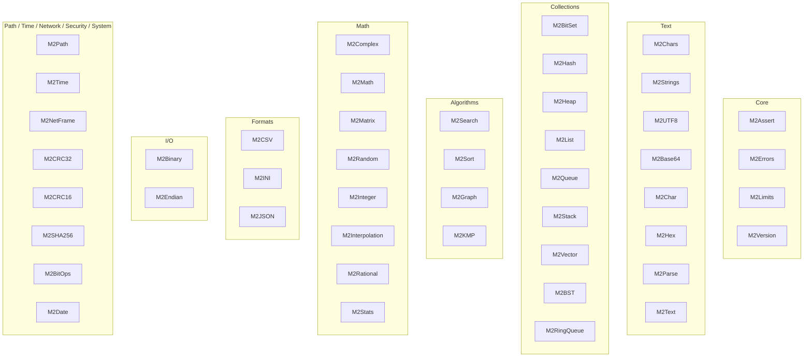

<!-- SPDX-License-Identifier: LicenseRef-Sovereign-Leviathan-SL-AGPL3-001 -->
<!-- Copyright (c) 2026 Ahmad Ali Parr. All rights reserved. -->
<!-- Authored by Ahmad Ali Parr. -->
<!-- Licensed under the SNAPKITTY OPAQUE SOURCE LICENSE v1.0. See LICENSE. -->

# M2Lib — Modula-2 Library

Paired Modula-2 definition (`.def`) and implementation (`.mod`) modules organized by domain.
Source is authored for a classic Modula-2 module model with GNU Modula-2 runtime
assumptions where stated. Exact compiler compatibility is not claimed until compiled
with a pinned toolchain.

> License: SNAPKITTY OPAQUE SOURCE LICENSE v1.0
> (`LicenseRef-Sovereign-Leviathan-SL-AGPL3-001`). See `LICENSE`.
> Every file in the repo carries the Opaque header, except the two
> `LICENSE` files themselves (which start with the SPDX identifier) and
> four build artifacts in `archive/` (two `.json`, two `.log`) where a
> header would corrupt the data or falsify the log. No `.txt`, `.zip`,
> or source-dump files remain.

## Layout

| Path | Contents |
|---|---|
| `src/` | 46 modules, one directory per domain |
| `examples/` | 14 demos, written not executed |
| `tests/unit/` | Modula-2 tests incl. 33 edge-case checks |
| `tests/integration/` | Reserved for end-to-end `gm2` runs |
| `benchmarks/` | Reserved; no numbers claimed |
| `docs/` | Architecture, edge cases, module ledger, provenance |
| `archive/` | First generation (2026-10-18), 34 modules, same license/headers |

## Domains

| Domain | Modules | Count |
|---|---|---|
| Core | M2Assert, M2Errors, M2Limits, M2Version | 4 |
| Text | M2Chars, M2Strings, M2UTF8, M2Base64, M2Char, M2Hex, M2Parse, M2Text | 8 |
| Collections | M2BitSet, M2Hash, M2Heap, M2List, M2Queue, M2Stack, M2Vector, M2BST, M2RingQueue | 9 |
| Algorithms | M2Search, M2Sort, M2Graph, M2KMP | 4 |
| Math | M2Complex, M2Math, M2Matrix, M2Random, M2Integer, M2Interpolation, M2Rational, M2Stats | 8 |
| Formats | M2CSV, M2INI, M2JSON | 3 |
| I/O | M2Binary, M2Endian | 2 |
| Filesystem | M2Path | 1 |
| Time | M2Time | 1 |
| Network | M2NetFrame | 1 |
| Security | M2CRC32, M2CRC16, M2SHA256 | 3 |
| System | M2BitOps, M2Date | 2 |
| **Total** | | **46** |

Full dependency notes and known boundaries (incl. the `M2Binary`/`M2Endian`
name collision and the `M2SHA256` fails-closed behavior) are in
[docs/architecture.md](docs/architecture.md).

## Build

Run `./build/build.sh`. The script reports a hard blocker if `gm2` is unavailable.
`tools/check_source.py` checks pairing and inventory; it is not a compiler substitute.
`tools/check_edge_cases.py` checks the edge-case table and test file stay in sync.

## Demos

Every demo uses only procedures in the imported modules' `.def` files.
All are written, not executed — `gm2` is unavailable, so no run claim is made.

| Demo | Covers |
|---|---|
| `vector_demo.mod` (supplied) | M2Vector |
| `sort_search_demo.mod` | M2Sort, M2Search |
| `stack_demo.mod` | M2Stack |
| `queue_demo.mod` | M2Queue |
| `list_demo.mod` | M2List |
| `hash_crc_demo.mod` | M2Hash, M2CRC32, M2Strings |
| `math_demo.mod` | M2Math, M2Complex, M2Matrix, M2Time, M2Limits |
| `formats_demo.mod` | M2CSV, M2INI, M2JSON, M2Path, M2NetFrame |
| `binary_demo.mod` | M2Endian |
| `binary_stream_demo.mod` | M2Binary |
| `core_demo.mod` | M2Version, M2Errors, M2Assert |
| `text_demo.mod` | M2Chars, M2Strings, M2UTF8 |
| `bits_demo.mod` | M2BitSet, M2Heap, M2Random |
| `security_demo.mod` | M2CRC32, M2SHA256 (fails closed) |

## Status

`docs/MODULES.md` tracks implementation separately from compilation/testing.
Source files alone are not evidence of compiler success.

| Check | Result |
|---|---|
| Pairing | 46 paired; 0 definition-only; 0 implementation-only |
| Source lines | 5,453 (4,993 pre-header + 460 header lines) |
| Edge-case checks | 33, traced from source, not executed |
| `gm2` compile | BLOCKED — compiler not installed |
| Archive pairing | 34 paired (first generation, `archive/`) |

SHA-256 fails closed rather than returning a fabricated digest until a portable
32-bit arithmetic backend is verified.

## Provenance

This repo holds two divergent generations. The 2026-10-18 generation lives in
`archive/`, and its code that the 2026-10-19 "complete" generation lacked was
merged into the main tree from the first generation (16 whole modules plus unique procedures in
13 overlapping modules) — see [docs/SOURCES.md](docs/SOURCES.md). Both trees
carry the Opaque license and headers; source content is unchanged apart from
headers, the archive's two `.txt` build records (now `.md`), its `LICENSE`
swap, and the labeled merge adaptations documented in `SOURCES.md`.
