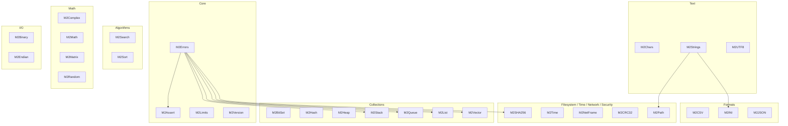

<!-- SPDX-License-Identifier: LicenseRef-Sovereign-Leviathan-SL-AGPL3-001 -->
<!-- Copyright (c) 2026 Ahmad Ali Parr. All rights reserved. -->
<!-- Authored by Ahmad Ali Parr. -->
<!-- Licensed under the SNAPKITTY OPAQUE SOURCE LICENSE v1.0. See LICENSE. -->

# M2Lib architecture — assistant-added

Main tree = complete generation (2026-10-19): 30 modules, 60 paired `.def`/`.mod` files,
2,888 source lines (2,588 pre-header + 300 header lines). Every module has exactly one definition and one implementation.
No compile or run claim: `gm2` was unavailable in the generation environment and on this VM.

## Domain map

Notes on the arrows (only the ones verified by reading the `.mod` files):

- `M2Errors` is imported by `M2Assert`, `M2Stack`, `M2Queue`, `M2List`, `M2Vector`, `M2SHA256`.
- `M2Strings` is imported by `M2Path` and `M2INI`.
- Everything else in the diagram is a domain grouping, not a claimed dependency.
- Several modules import runtime modules that are **not** in this repo
  (`StrIO`, `NumberIO`, `Storage`, `SYSTEM`): `M2Errors`, `M2Assert`, `M2Vector`.
  That is an open compiler-compatibility question, not a verified fact.

## Module inventory (main tree)

| Domain | Modules |
|---|---|
| Core | M2Assert, M2Errors, M2Limits, M2Version |
| Text | M2Chars, M2Strings, M2UTF8 |
| Collections | M2BitSet, M2Hash, M2Heap, M2List, M2Queue, M2Stack, M2Vector |
| Algorithms | M2Search, M2Sort |
| Math | M2Complex, M2Math, M2Matrix, M2Random |
| Formats | M2CSV, M2INI, M2JSON |
| I/O | M2Binary, M2Endian |
| Filesystem | M2Path |
| Time | M2Time |
| Network | M2NetFrame |
| Security | M2CRC32, M2SHA256 |

## Known boundaries (from the supplied sources)

- `M2SHA256.DigestHex` fails closed: it returns `FALSE`, empties `out`, and reports
  `ErrNotSupported` ("SHA-256 backend requires verified 32-bit unsigned arithmetic").
  No digest is ever returned.
- `M2Binary` and `M2Endian` both export `ReadBE32` / `WriteBE32` with different
  signatures. They must not be `FROM`-imported into the same client module;
  the demos keep them in separate files (`binary_demo.mod`, `binary_stream_demo.mod`).
- `M2Stack`, `M2Queue`, `M2List` all export `Create` / `Destroy`. Clients needing
  more than one use qualified `IMPORT M2Stack, M2Queue, M2List` (see
  `tests/unit/test_edge_cases.mod`); `M2Chars` / `M2Strings` both export
  `ToUpper` / `ToLower` (see `examples/text_demo.mod`).

## Layout

| Path | Contents |
|---|---|
| `src/` | Main tree, one directory per domain |
| `examples/` | 14 demos (incl. supplied `vector_demo.mod`), written not executed |
| `tests/unit/` | Modula-2 tests: supplied `test_all`, `test_core`, assistant-added `test_edge_cases` |
| `tests/integration/` | Reserved for end-to-end `gm2` runs once a toolchain exists |
| `tests/vectors/` | Reserved for test vectors |
| `benchmarks/` | Reserved; no benchmark numbers are claimed |
| `tools/` | `check_source.py` (supplied), `check_edge_cases.py` (assistant-added) |
| `build/` | `build.sh` (supplied; exits 2 with BLOCKED when `gm2` is absent) |
| `docs/` | This file, `edge-cases.md`, `api/` (reserved) |
| `archive/first-generation-2026-10-18/` | First generation, verbatim, 34 modules / 68 files |
| `docs/SOURCES.md` | Provenance: how the two generations were identified and kept separate |
