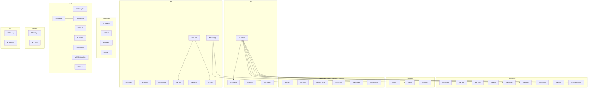

<!-- SPDX-License-Identifier: LicenseRef-Sovereign-Leviathan-SL-AGPL3-001 -->
<!-- Copyright (c) 2026 Ahmad Ali Parr. All rights reserved. -->
<!-- Authored by Ahmad Ali Parr. -->
<!-- Licensed under the SNAPKITTY OPAQUE SOURCE LICENSE v1.0. See LICENSE. -->

# M2Lib architecture — assistant-added

Main tree = complete generation (2026-10-19) plus cherry-picked code from the
first generation (see `SOURCES.md`): 46 modules, 92 paired `.def`/`.mod` files,
5,453 source lines (4,993 pre-header + 460 header lines). Every module has exactly one definition and one implementation.
No compile or run claim: `gm2` was unavailable in the generation environment and on this VM.

## Domain map

Notes on the arrows (only the ones verified by reading the `.mod` files):

- `M2Errors` is imported by `M2Assert`, `M2Stack`, `M2Queue`, `M2List`, `M2Vector`, `M2SHA256`, `M2RingQueue`.
- `M2Strings` is imported by `M2Path` and `M2INI`.
- `M2Char` is imported by `M2Hex`, `M2Parse`, `M2Text`; `M2Integer` is imported by `M2Rational`.
- Everything else in the diagram is a domain grouping, not a claimed dependency.
- Several modules import runtime modules that are **not** in this repo
  (`StrIO`, `NumberIO`, `Storage`, `SYSTEM`): `M2Errors`, `M2Assert`, `M2Vector`, `M2BitOps` (`SYSTEM` for `TSIZE`).
  That is an open compiler-compatibility question, not a verified fact.

## Module inventory (main tree)

| Domain | Modules |
|---|---|
| Core | M2Assert, M2Errors, M2Limits, M2Version |
| Text | M2Chars, M2Strings, M2UTF8, M2Base64, M2Char, M2Hex, M2Parse, M2Text |
| Collections | M2BitSet, M2Hash, M2Heap, M2List, M2Queue, M2Stack, M2Vector, M2BST, M2RingQueue |
| Algorithms | M2Search, M2Sort, M2Graph, M2KMP |
| Math | M2Complex, M2Math, M2Matrix, M2Random, M2Integer, M2Interpolation, M2Rational, M2Stats |
| Formats | M2CSV, M2INI, M2JSON |
| I/O | M2Binary, M2Endian |
| Filesystem | M2Path |
| Time | M2Time |
| Network | M2NetFrame |
| Security | M2CRC32, M2CRC16, M2SHA256 |
| System | M2BitOps, M2Date |

## Known boundaries (from the supplied sources)

- `M2SHA256.DigestHex` fails closed: it returns `FALSE`, empties `out`, and reports
  `ErrNotSupported` ("SHA-256 backend requires verified 32-bit unsigned arithmetic").
  No digest is ever returned.
- `M2Binary` and `M2Endian` both export `ReadBE32` / `WriteBE32` with different
  signatures. They must not be `FROM`-imported into the same client module;
  the demos keep them in separate files (`binary_demo.mod`, `binary_stream_demo.mod`).
- `M2Stack`, `M2Queue`, `M2List` all export `Create` / `Destroy`. Clients needing
  more than one use qualified `IMPORT M2Stack, M2Queue, M2List` (see
  `tests/unit/test_edge_cases.mod`); `M2Chars` / `M2Strings` both export
  `ToUpper` / `ToLower` (see `examples/text_demo.mod`).
- Cherry-picked modules add more shared names: `M2BST` / `M2Graph` / `M2RingQueue`
  all export `Create` / `Destroy`; `M2Base64` / `M2Hex` both export `Encode` / `Decode`;
  `M2Text` / `M2KMP` both export `Find`. Clients use qualified `IMPORT` for these
  (see `examples/cherry_pick_demo.mod`).
- `M2Graph` BFS/DFS are a known defect: the `.def` declares a BOOLEAN result,
  the `.mod` implements them with no return. They are ported verbatim from the
  first generation; do not call them until the mismatch is fixed.
- `M2Char.IsSpace` differs from `M2Chars.IsSpace`: the cherry-picked version
  also accepts 18 (12X) and 64 (40X). `M2Text.Length` stops at `HIGH(s)` where
  `M2Strings.Length` stops at `HIGH(s)+1`, so a NUL-free full array reads one
  short. Both are ported verbatim; the differences are intentional to preserve.
- `M2Interpolation.Trapezoid` / `Bisect` integrate and root-find only the fixed
  function x^3 - x - 2 (private `FunctionValue`), not a caller-supplied function.
- Merged modules carry two APIs side by side, not one rewritten API:
  `M2Binary` (byte-array `ReadBE32`/`WriteBE32` + streaming `Reader`/`Writer`),
  `M2Matrix` (`Matrix2` record + flat-array `Multiply`/`Solve`/…),
  `M2Random` (module-state `Seed`/`Next` + explicit-state `Generator`/`Bounded`/`UnitReal`),
  `M2Sort` (`HIGH`-based sorts + explicit-`n` `ShellSort`/`IsSorted`).

## Layout

| Path | Contents |
|---|---|
| `src/` | Main tree, one directory per domain |
| `examples/` | 15 demos (incl. supplied `vector_demo.mod`), written not executed |
| `tests/unit/` | Modula-2 tests: supplied `test_all`, `test_core`, assistant-added `test_edge_cases` |
| `tests/integration/` | Reserved for end-to-end `gm2` runs once a toolchain exists |
| `benchmarks/` | Reserved; no benchmark numbers are claimed |
| `tools/` | `check_source.py` (supplied), `check_edge_cases.py` (assistant-added) |
| `build/` | `build.sh` (supplied; exits 2 with BLOCKED when `gm2` is absent) |
| `docs/` | This file, `edge-cases.md`, `MODULES.md`, `SOURCES.md` |
| `archive/first-generation-2026-10-18/` | First generation, 34 modules / 68 files; cherry-picked into the main tree (see `SOURCES.md`) |
| `docs/SOURCES.md` | Provenance: how the two generations were identified and kept separate |
